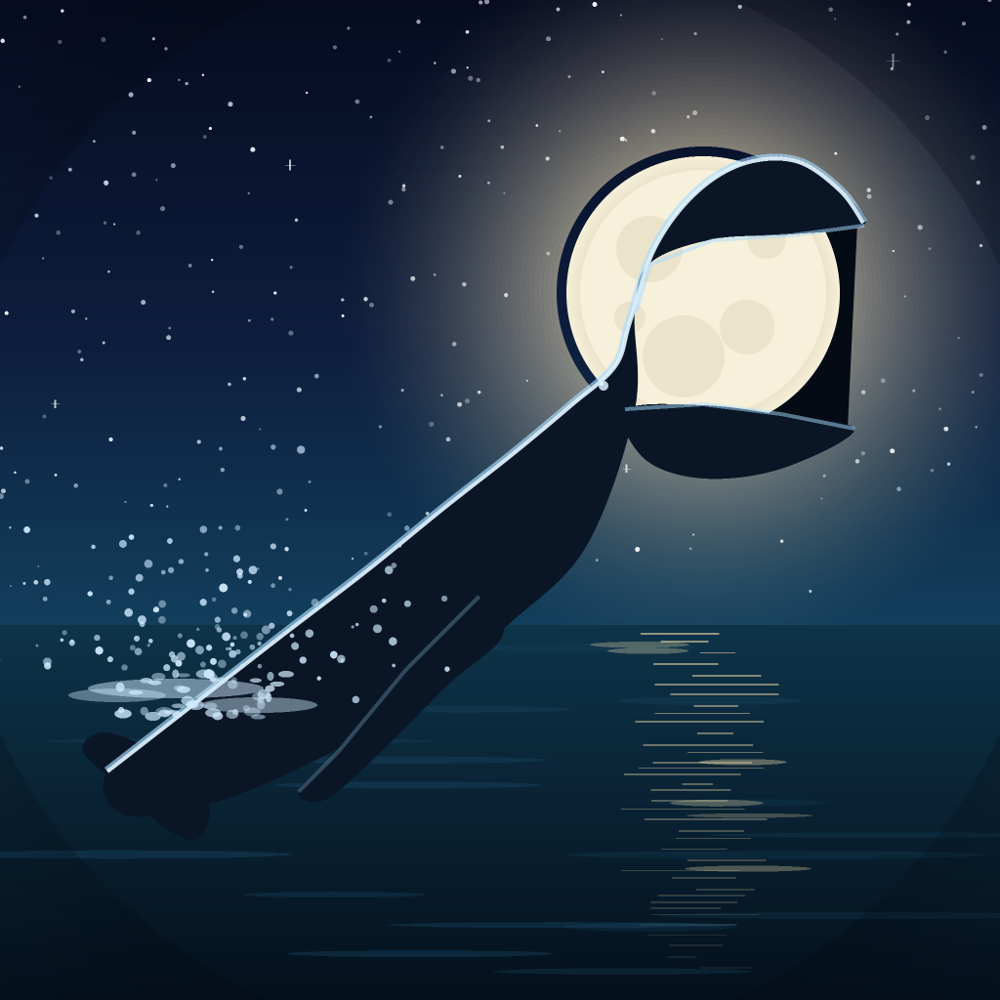

# The Whale That Swallowed the Moon

[](https://make.fun/bounty/ai-excited-01?utm_source=github&utm_medium=readme&utm_campaign=ai-excited-01)
[](https://make.fun/bounty/ai-excited-01/leaderboard?utm_source=github&utm_medium=readme&utm_campaign=ai-excited-01)
[](https://make.fun/bounty/ai-excited-01?utm_source=github&utm_medium=readme&utm_campaign=ai-excited-01)

Entry for make.fun **ai-excited-01** — one image that gets the AI judge excited. See the bounty: https://make.fun/bounty/ai-excited-01



## The idea

A humpback whale breaches out of a midnight sea, head-first toward the sky —
and the full moon is caught in its open jaws. Scale, momentum, and a twist:
the moon is not above the whale, it is *inside* the whale's mouth, about to
be swallowed whole. No explosion, no fireworks — one impossible moment,
frozen mid-breach.

## How it is made

`main.py` is a pure-Python (stdlib only) renderer. It writes `entry.png`
(1024×1024, deterministic — two runs produce byte-identical output):

- a hand-written PNG encoder (`zlib` + `struct`, no libraries)
- a scanline rasterizer: gradients, Catmull-Rom spline polygons for the
  whale, analytic circle spans for the moon and spray, radial moon glow,
  seeded star field, moonlight column on the water
- 2× supersampling: the scene is rasterized at 2048×2048 and downsampled
  to 1024×1024 for clean edges

## Run it

```sh
python3 main.py            # writes out/entry.png
MAKEFUN_OUTPUT_DIR=/output python3 main.py
```

Two runs must write the same bytes (`sha256sum` them to check).

## License

MIT — see [LICENSE](LICENSE).
